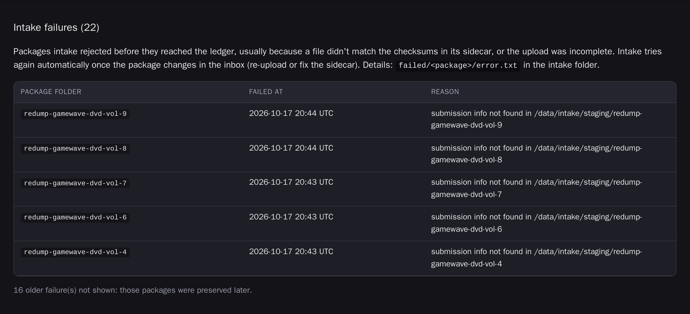

# How to add material to the HitSave archive and follow it through

This guide is for archivists who add community dumps to the archive and look after their catalog
records. It covers four tasks:

- Add a dump from Google Drive or Wasabi.
- Check its progress in the ledger.
- Fix, publish, hide or quarantine its catalog record.
- Understand what's stored in each package and how the system checks it.

You don't need a terminal for any of these. You need access to the shared Google Drive inbox or the
Wasabi incoming bucket, and to **status-web**, the archive's staff dashboard. Ask an admin for its
address. Today it's `http://saturn:8090`; after the move to the new server it will be a tailnet
address behind a Pocket ID login.

## What happens after you upload

You put a package in an inbox. Every 30 minutes the system checks the inboxes, and for each new
package it:

1. **Downloads and verifies it.** In `redump/` and `no-intro/`, every file is checked against the
   checksums in the package's sidecar file; if any file doesn't match, the package stops here.
2. **Scans it for viruses** with ClamAV, and checks it against the content policy.
3. **Packages it as a bag**: a standard archival folder (BagIt) that lists a checksum for every file.
4. **Uploads the bag to Wasabi**, the permanent copy, and checks every uploaded file.
5. **Records it in the ledger**, the archive's list of every package and its state.
6. **Creates a catalog item** on [archive.hitsave.org](https://archive.hitsave.org). The item starts
   **private**, so only staff can see it until you publish it.

The system waits until a package has been **unchanged for one hour** before starting, so it never
picks up a half-finished upload. A typical DVD dump goes from the end of its upload to a private
catalog item in about two hours.

## Pick the right folder

Google Drive and the Wasabi `hitsave-incoming` bucket have the same three inbox folders. The folder
you use decides what the system checks:

| Folder | For | Needs |
|---|---|---|
| `redump/` | Disc dumps made for [Redump](https://redump.info) | the Redump sidecar `!submissionInfo.txt` (or `submissionInfo.txt`) |
| `no-intro/` | Cartridge dumps made for No-Intro, including Nintendo Switch carts | `dumpinfo.txt` (or `!dumpinfo.txt`), or for a Switch cart the `… Submission.xml` from the dumping tool |
| `others/` | Anything without a sidecar | nothing |

In `redump/` and `no-intro/` every file is checked against the sidecar's checksums before anything
is preserved. `others/` has no sidecar to check against, so its files are preserved exactly as
uploaded (still virus-scanned, packaged with a checksum per file, and fixity-checked later).

If a dump is in the wrong folder, for example a No-Intro dump in `redump/`, it isn't ingested. It
shows up under **Intake failures** with a hint such as "this looks like a No-Intro dump: move it to
no-intro/". Move it to the right folder and the next sweep picks it up.

## Add a dump from Google Drive

1. Open the shared drive and the right inbox folder: `redump`, `no-intro` or `others`.
2. Create **one folder per dump**, named after it. For example: `Famitsu Wave DVD 2008-12 Disc 2`.
3. Put everything for that dump in the folder:
   - the image files: disc images such as `.iso` or `.bin` and `.cue`, or ROM / cart files
   - the sidecar for that folder (see the table above; none for `others`)
   - anything else you want kept with it, such as scans or dumping logs. The system preserves
     every file in the folder.
4. Leave the folder alone. The system starts on a folder only after **every file in it has been
   unchanged for one hour**, so a slow upload is safe.

## Add a dump from Wasabi

1. In the Wasabi console, open the `hitsave-incoming` bucket.
2. Open the right inbox prefix: `redump/`, `no-intro/` or `others/`. Only these three are watched;
   anything uploaded elsewhere in the bucket is ignored.
3. Upload **one folder per dump** into it, for example `no-intro/Aka 1.0.6/`, with the same
   contents as for Drive.
4. Leave the folder alone. As with Drive, the system waits until nothing in the folder has changed
   for one hour.

## What happens to the inbox copy

Once a dump is preserved (ledger status `complete`), the system moves its folder to
`processed/redump/`, `processed/no-intro/` or `processed/others/`, on the same surface it came from.
An empty inbox therefore means everything in it has been handled. Don't move folders into
`processed/` yourself: a folder moved there before it's preserved is never ingested.

## Check progress in the ledger

Open status-web. The **Ledger** page lists every package, newest first.

1. Type words from the title into the search box, then click **Search**. For example:
   `famitsu wave dvd 2008-12`. Every word must appear, in any order; capitals, dashes and
   punctuation don't matter, and the start of a word is enough (`famit` finds `famitsu`). You can
   also search by Omeka item number, status (`quarantine`) or system (`playstation`).

   

2. Read the **Status** column:

| Status | Meaning | What to do |
|---|---|---|
| `registered`, `scanning`, `building_bagit`, `uploading_package` | Still being processed | Wait |
| `complete` | Safely on Wasabi and in the ledger | Check the catalog item (below) |
| `quarantine` | Stopped on purpose: a virus was found (`Virus detected in …`), the content policy flagged it, or someone quarantined it. The **Error** column says why. Nothing was uploaded. | Read the reason; tell an admin about a virus straight away |
| `failed` | Processing stopped because something went wrong, for example an upload problem. The **Error** column says why. | Tell an admin |

3. When the status is `complete`, the **Omeka** column links to the catalog item. Open it and check
   the title and description.

The **Health** page starts with counts by status and the flags that need attention:


Below the counts it lists everything that needs attention:

- **Attention queue**: quarantined or failed packages, packages with an error, and completed
  packages without a catalog item.
- **Intake failures**: packages that never reached the ledger, for example because a file didn't
  match the checksums in the sidecar, the sidecar was missing, or the dump is in the wrong folder.
  The **Reason** column says which.

If both lists are empty, nothing needs you.



**To fix an intake failure**, correct the package in the inbox: re-upload the damaged file, or
replace a wrong sidecar. The system notices the change and tries again on its own; it doesn't
retry a package that hasn't changed.

The **Windmill runs** page shows the background jobs and whether each one succeeded: the inbox
sweep, the nightly backup, the fixity check and the cleanup.

## Fix a catalog record

Every ledger row has these actions: **admin** (Omeka admin page), **site** (public page),
**correct**, **quarantine**, **publish** and **hide**.

To fix a title or other details:

1. Click **correct** on the ledger row. The form opens with the Omeka item filled in.

   

2. Fill in only the fields you want to change:
   - **Title**
   - **MobyGames URL**, the correct MobyGames page
   - **Description**
   - **Developer(s)** and **Publisher(s)**, separated by commas
   - **Former title** and **Correction summary**, which go into the package's notes
3. If the system matched the wrong MobyGames game, tick **Clear MobyGames catalog** instead of
   entering a URL. That removes the Moby link, description and credits, and restores the press-kit
   description.
4. Leave **Upload bag metadata to Wasabi when title or Moby URL changes** ticked. The package's own
   metadata on Wasabi then matches the catalog.
5. Click **Apply correction**. The page shows the result of the correction job when it finishes, usually within a minute.

## Publish or hide an item

New items start private. When you've checked an item, click **publish** on its ledger row; it
appears on the public site straight away. Click **hide** to make it private again. Neither button
changes the package on Wasabi.

## Quarantine an item

Quarantine an item that shouldn't be in the public archive, for example material that isn't press
material, or files with meaningless hash names.

1. Click **quarantine** on the ledger row.
2. Pick a **block reason** and write a **curation note** explaining why. Both are required.
3. Submit. The ledger status changes to `quarantine` and the catalog item is hidden from the public.

The preserved copy on Wasabi stays untouched. Releasing an item from quarantine isn't possible from
status-web yet; ask an admin.

## What's in a package

Each package is a **bag**: a folder in the [BagIt](https://www.rfc-editor.org/rfc/rfc8493) format,
stored unpacked on Wasabi. For example:

```text
dumps/Redump/DVD-Video/Coverdiscs/F/famitsu-wave-dvd-2008-12-gatsugou-tokubetsu-furoku-01a136e7-…/
├── data/                          the files exactly as submitted, folder structure kept
├── manifest-sha256.txt            a SHA-256 checksum for every file in data/
├── tagmanifest-sha256.txt         checksums for the files below
├── bag-info.txt                   package id, source, bagging date, size
└── metadata/
    ├── submission.json            where the material came from and when it was ingested
    ├── inventory.json             every file: path, size, checksum, file type
    ├── premis/                    virus-scan records (one per scan)
    └── hitsave/                   preview images and thumbnails for the catalog viewer
```

Where packages live on Wasabi:

| Material | Bucket | Path |
|---|---|---|
| Redump dumps | `hitsave-dumps` | `dumps/Redump/{System}/{Category}/{first letter}/{package id}/` |
| No-Intro dumps | `hitsave-dumps` | `dumps/No-Intro/{System}/{first letter}/{package id}/` |
| Nintendo Switch cart dumps (No-Intro) | `hitsave-dumps` | `dumps/No-Intro/Nintendo - Nintendo Switch/{first letter}/{package id}/` |
| Other dumps | `hitsave-dumps` | `dumps/Others/{first letter}/{package id}/` |
| Press material | `hitsave-press-material` | `press-material/{first letter}/{package id}/` |

The package id is the title in lowercase with dashes, plus a unique code, for example
`famitsu-wave-dvd-2008-12-gatsugou-tokubetsu-furoku-01a136e7-6b05-7754-a838-5cf2d5be15e5`.

## How material is checked

### Before it's preserved

| Check | What it catches | If it fails |
|---|---|---|
| **Upload settled** (1 hour unchanged, Drive and Wasabi) | Uploads still in progress | Waits, then tries again |
| **Sidecar checksums** (size, MD5, SHA-1, CRC32; `redump/` and `no-intro/`) | Corrupt or incomplete files, wrong sidecar | Listed under **Intake failures** on the Health page; never reaches the ledger. Retried once the package changes. |
| **Virus scan** (ClamAV, every byte of every file) | Known malware | Ledger status `quarantine` (`virus_detected`); nothing uploaded |
| **Content policy** | Booru-style or hash-named image files | Ledger status `quarantine`; nothing uploaded |
| **Bag validation** | Missing or changed files while packaging | Ledger status `failed` |
| **Upload check** (size and checksum of every file on Wasabi) | Damaged uploads | Ledger status `failed`; retried on the next run |

The virus-scan result is stored in the package under `metadata/premis/`.

### After it's preserved

| What | When | Purpose |
|---|---|---|
| **Fixity check** | Nightly at 03:00 UTC; each package at most every 90 days, and new packages on their first night | Downloads the package from Wasabi and recomputes every checksum. Catches silent damage. |
| **Ledger backup** | Nightly at 02:30 UTC | Keeps 30 days of ledger copies |
| **Cleanup of local copies** | Nightly at 04:30 UTC, 14 days after upload | Deletes the temporary copy on the server, but only after proving the Wasabi copy is identical |

A failed fixity check shows up as a failed job on the **Windmill runs** page. Tell an admin
straight away.

## More detail

- [remote-intake-lanes.md](./remote-intake-lanes.md): how Drive and Wasabi intake works, for operators
- [storage-retention.md](./storage-retention.md): which copies are permanent and why fixity runs every 90 days
- [dump-preservation.md](./dump-preservation.md): how dumps are classified (Redump, No-Intro)
- [oais-bagit-preservation-plan.md](./oais-bagit-preservation-plan.md): the preservation model in full
