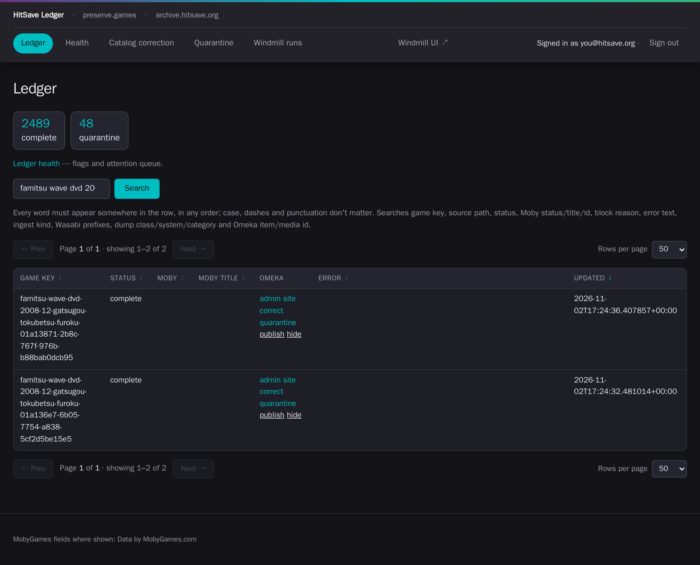
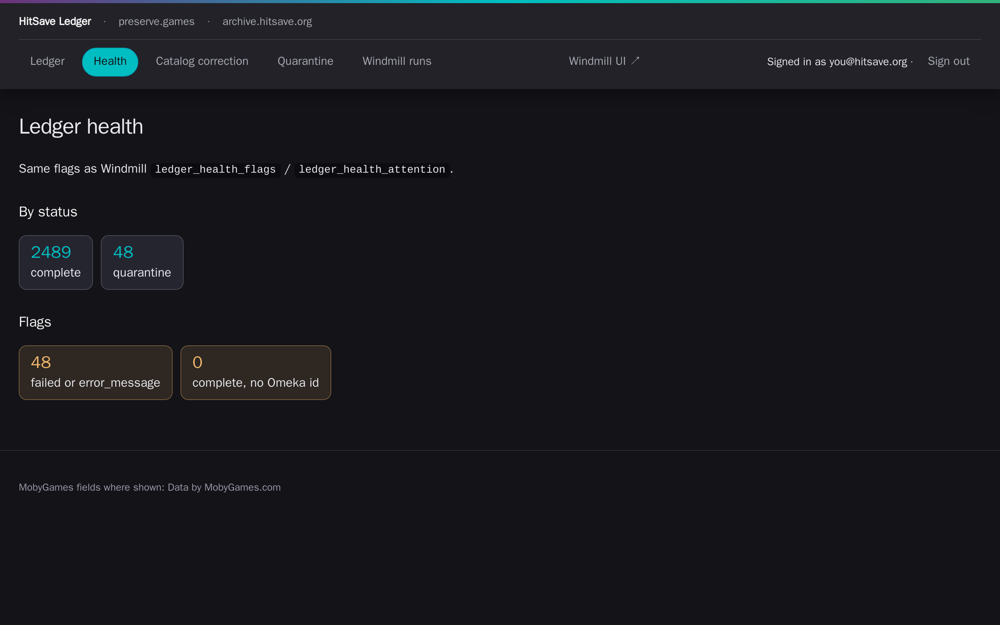
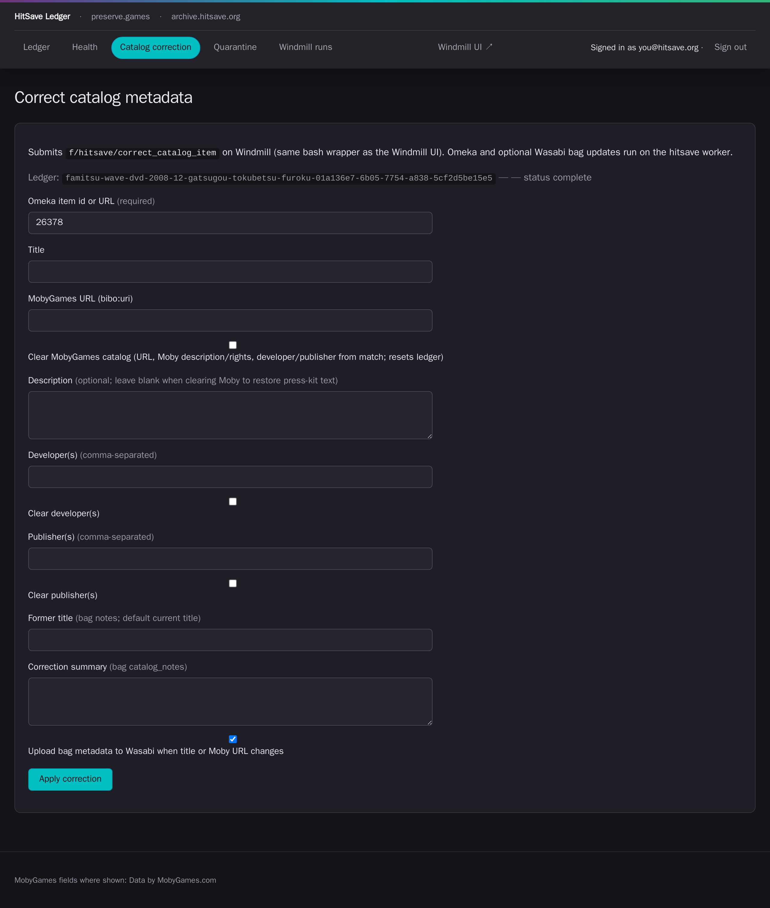

# How to add material to the HitSave archive and follow it through

This guide is for HitSave archivists. It shows you how to put a dump or other material into the
archive, follow it until it has a catalog record, and fix or publish that record. You don't need a
terminal for any of it.

The result of every upload is a row like this in the **ledger**, the archive's staff dashboard, with
a link to the new catalog record on [archive.hitsave.org](https://archive.hitsave.org):



## Before you start

You need three things. Ask an admin for any you don't have.

1. **Tailscale**, connected to the HitSave tailnet. The ledger is only reachable through it.
2. Your **`@hitsave.org` account** in Pocket ID, the HitSave staff login.
3. Access to the **HitSave shared drive** on Google Drive, or a **Wasabi** login for the
   `hitsave-incoming` bucket.

To check that you're set up, open [ledger.hitsave.org](https://ledger.hitsave.org) and sign in with
Pocket ID. You should see the Ledger page, with **Signed in as** and your email address in the top
bar.

If your browser says it can't find the site, connect Tailscale and try again. If it still can't,
tell an admin: some home routers and ad blockers hide addresses that only exist on the tailnet.

## How an upload becomes a catalog record

You put a folder in an inbox. Every 30 minutes the archive checks the inboxes, and for each new
folder it:

1. Waits until nothing in the folder has changed for **one hour**, so it never takes a half-finished
   upload.
2. Checks every file against the checksums in the folder's **sidecar**, the information file the
   dumping tool writes (only in the `redump` and `no-intro` inboxes).
3. Scans every file for viruses.
4. Packs the folder into a **package**: an archival folder that lists a checksum for every file.
5. Uploads the package to Wasabi, the permanent copy, and checks every uploaded file.
6. Adds the package to the ledger.
7. Creates a **private** catalog record on archive.hitsave.org. Only staff can see it until you
   publish it.
8. Moves your folder from the inbox to the `processed` folder.

A typical DVD dump takes about two hours from the end of its upload to a private catalog record.

## Choose the inbox folder

Google Drive and Wasabi have the same three inboxes. On Drive they're at the top of the HitSave
shared drive; on Wasabi they're folders in the `hitsave-incoming` bucket.

| Inbox | Put here | It must contain | The catalog title comes from |
|---|---|---|---|
| `redump` | Disc dumps made for [Redump](https://redump.info) | The Redump sidecar, `!submissionInfo.txt` | The title in the sidecar |
| `no-intro` | Cartridge dumps made for No-Intro, including Nintendo Switch carts | The No-Intro sidecar, `dumpinfo.txt`, or for a Switch cart the `Submission.xml` from the dumping tool | The game name in `dumpinfo.txt`; for a Switch cart, the folder name |
| `others` | Anything without a sidecar | Nothing extra | The folder name |

The archive doesn't check files in `others` against anything, because there's no sidecar to check
them against. It still scans them for viruses, records a checksum for every file, and rechecks the
Wasabi copy regularly.

Name each folder after what's in it, especially in `others`, where the folder name becomes the
catalog title. You can still [fix a title](#fix-a-catalog-record) later.

## Add material from Google Drive

1. Open the HitSave shared drive, then the inbox you chose: `redump`, `no-intro` or `others`.
2. Create one folder for the dump and name it after the dump, for example
   `Famitsu Wave DVD 2008-12 Disc 2`.
3. Upload everything for that dump into the folder:
   - the image files, such as `.iso`, `.bin` and `.cue` for a disc, or the ROM or cart image
   - the sidecar (see [Choose the inbox folder](#choose-the-inbox-folder); none for `others`)
   - anything else you want kept with it, such as scans or dumping logs

   Subfolders are fine. A Switch cart, for example, usually has a `Scans` folder and a version
   folder such as `1.0.6`. The archive keeps every file and the folder structure.
4. Leave the folder alone. The archive starts on it once nothing in it has changed for an hour, so a
   slow upload is safe.

## Add material from Wasabi

1. In the Wasabi console, open the `hitsave-incoming` bucket, then the inbox you chose: `redump`,
   `no-intro` or `others`. The archive only watches these three; it ignores everything else in the
   bucket.
2. Upload one folder for the dump into it, for example `no-intro/Aka 1.0.6/`, with the same contents
   as for Drive.
3. Leave the folder alone. As on Drive, the archive starts once nothing has changed for an hour.

## Follow your package in the ledger

1. Open [ledger.hitsave.org](https://ledger.hitsave.org). The **Ledger** page lists every package,
   newest first.
2. Type words from the title into the search box and click **Search**, for example
   `famitsu wave dvd 2008-12`. The words can be in any order, and capitals and punctuation don't
   matter. The start of a word is enough: `famit` finds `famitsu`. You can also search for a catalog
   item number, a status such as `quarantine`, or a system such as `playstation`.
3. Read the **Status** column:

   | Status | What it means | What to do |
   |---|---|---|
   | `registered`, `scanning`, `building_bagit`, `uploading_package` | The archive is still working on it. | Wait. |
   | `complete` | The package is safely on Wasabi, and the archive has moved your folder to `processed`. | Check the catalog record (next step). |
   | `quarantine` | The archive stopped it on purpose: it found a virus, the files broke the content rules, or someone quarantined it. The **Error** column says which. The archive uploaded nothing. | Read the reason. Tell an admin straight away about a virus. |
   | `failed` | Something went wrong, for example during the upload. The **Error** column says what. | Tell an admin. |

4. When the status is `complete`, click the link in the **Omeka** column to open the catalog record,
   and check its title and description.

The **Health** page shows the same packages from the other side: counts by status, and an
**Attention queue** of every package that needs someone, such as quarantined or failed packages and
complete packages without a catalog record. If the attention queue is empty, nothing needs you.



### If your package doesn't appear

If a package hasn't appeared in the ledger three hours after its upload finished, the archive
probably rejected it before it got that far. The usual reasons are:

- A file doesn't match the checksums in the sidecar, often because the upload was cut short.
- The sidecar is missing.
- The dump is in the wrong inbox, for example a No-Intro dump in `redump`.

The ledger can't show these rejections at the moment, so ask an admin, who can see the reason. To
fix the problem, correct the folder in the inbox: upload the damaged file again, add or replace the
sidecar, or move the folder to the right inbox. The archive notices the change and tries again on
its own. It doesn't retry a folder that hasn't changed.

## Leave the inbox and processed folders to the archive

When a package reaches `complete`, the archive moves its folder from the inbox to
`processed/redump`, `processed/no-intro` or `processed/others`, on Drive or Wasabi, wherever it
came from. So an inbox holds only folders that are waiting or that need attention.

- Don't move folders into `processed` yourself. The archive never picks up a folder from there.
- Don't delete anything in `processed`. Those folders are the contributors' originals.
- Don't delete a folder whose package is in `quarantine`. Tell an admin instead; the archive
  doesn't retry quarantined packages.

## Fix a catalog record

Every row in the ledger has six links: **admin** opens the record in the Omeka admin, **site** opens
the public page, and **correct**, **quarantine**, **publish** and **hide** change the record.

To fix a title or other details:

1. Click **correct** on the package's row. The **Correct catalog metadata** page opens with the
   catalog item filled in.

   

2. Fill in only the fields you want to change:
   - **Title**
   - **MobyGames URL**: the address of the right game on [MobyGames](https://www.mobygames.com)
   - **Description**
   - **Developer(s)** and **Publisher(s)**, separated by commas. To remove them instead, tick
     **Clear developer(s)** or **Clear publisher(s)**.
   - **Former title** and **Correction summary**: notes kept with the package. The ledger adds your
     email address to the summary.
3. If the archive linked the wrong MobyGames game, tick **Clear MobyGames catalog** instead of
   entering a URL. That removes the MobyGames link, description and credits. For press material it
   also puts back the description from the press kit.
4. Leave **Upload bag metadata to Wasabi when title or Moby URL changes** ticked, so the copy of the
   details stored with the package on Wasabi matches the catalog.
5. Click **Apply correction**. The page shows the result when the correction finishes, usually
   within a minute.

## Publish or hide a catalog record

New catalog records are private. When you've checked a record, click **publish** on its row in the
ledger; the record appears on the public site straight away. Click **hide** to make it private
again. Neither link changes the package on Wasabi.

## Quarantine a catalog record

Quarantine a record that shouldn't be in the public archive, for example press material that isn't
press-kit material, or images with meaningless names.

1. Click **quarantine** on the package's row.
2. Choose a reason in **block_reason**, or leave `curation_review` if none fits, and write a
   **Curation note** that explains why. The note is required, and the ledger adds your email
   address to it.
3. Click **Quarantine item**. The ledger status changes to `quarantine` and the catalog record
   disappears from the public site.

The package on Wasabi stays as it is. You can't release a record from quarantine in the ledger yet;
ask an admin.

## What's in a package

Each package is a folder on Wasabi in [BagIt](https://www.rfc-editor.org/rfc/rfc8493), a standard
archival format, for example:

```text
dumps/Redump/DVD-Video/Coverdiscs/F/famitsu-wave-dvd-2008-12-gatsugou-tokubetsu-furoku-01a136e7-…/
├── data/                          the files exactly as uploaded, folder structure kept
├── manifest-sha256.txt            a checksum for every file in data/
├── tagmanifest-sha256.txt         checksums for the files below
├── bag-info.txt                   package id, source, date packed, size
└── metadata/
    ├── submission.json            where the material came from and when the archive took it in
    ├── inventory.json             every file: path, size, checksum, file type
    ├── premis/                    the virus-scan records
    └── hitsave/                   preview images and thumbnails for the catalog viewer
```

Where the archive stores each kind of material:

| Material | Wasabi location |
|---|---|
| Redump dumps | `hitsave-dumps` › `dumps/Redump/` › system › category › first letter › package |
| No-Intro dumps, including Switch carts | `hitsave-dumps` › `dumps/No-Intro/` › system › first letter › package |
| Material from `others` | `hitsave-dumps` › `dumps/Others/` › first letter › package |
| Press material | `hitsave-press-material` › `press-material/` › first letter › package |

The package name is the title in lowercase with dashes, plus a unique code, for example
`famitsu-wave-dvd-2008-12-gatsugou-tokubetsu-furoku-01a136e7-6b05-7754-a838-5cf2d5be15e5`.

## How the archive checks your material

Before the archive preserves a package:

| Check | What it catches | If it fails |
|---|---|---|
| **Upload finished**: nothing changed for one hour | Uploads still in progress | The archive waits and checks again. |
| **Sidecar checksums**: size, MD5, SHA-1 and CRC32 of every file (`redump` and `no-intro`) | Damaged or incomplete files, or the wrong sidecar | The package never reaches the ledger; see [If your package doesn't appear](#if-your-package-doesnt-appear). |
| **Virus scan** of every file | Known malware | Status `quarantine`; nothing uploaded. |
| **Content rules** | Image collections with meaningless or tag-style file names, typical of image-board downloads | Status `quarantine`; nothing uploaded. |
| **Package check** | Files that went missing or changed while the archive packed them | Status `failed`. |
| **Upload check**: size and checksum of every file on Wasabi | Damaged uploads | Status `failed`; the archive tries again on the next run. |

After the archive preserves a package, it keeps checking it:

- **Every night** it downloads a batch of packages from Wasabi and recomputes every checksum, to
  catch damage. It checks each new package on its first night, and every package again about every
  90 days. A failed check shows as a failed job on the ledger's **Windmill runs** page; tell an
  admin straight away.
- **Every night** it backs up the ledger.
- **Every night** it deletes working copies on its own servers, but only for packages whose Wasabi
  copy it has checked. Wasabi is the copy that lasts.
