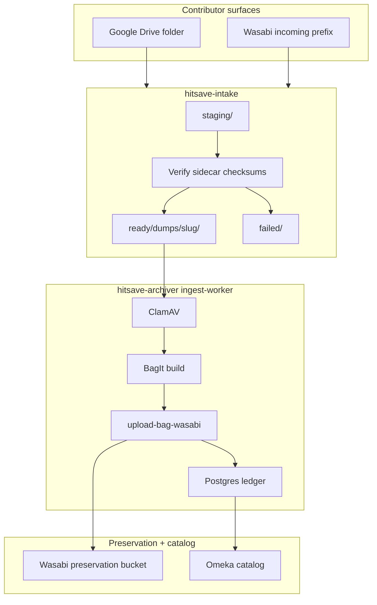

# Remote intake lanes (SSOT)

This document is the **single source of truth** for how Hit Save moves contributor material from **Google Drive** and **Wasabi incoming** into long-term preservation (BagIt, preservation Wasabi, Postgres ledger, Omeka catalog).

**Related repos**

| Repo | Role |
|------|------|
| [**hitsave-archiver**](https://github.com/hitsave/hitsave-archiver) (this repo) | ClamAV, BagIt, preservation Wasabi upload, ledger, Omeka registration |
| [**hitsave-intake**](https://github.com/hitsave/hitsave-intake) | Drive poll, Wasabi incoming poll, download, **fixity**, local `ready/` handoff YAML |
| **hitsave-archiver-config** (private) | Credentials, operator `database.yaml`, lane inventory (IDs/prefixes), optional `wasabi-*-intake.yaml` |

**Do not commit** Drive folder IDs, incoming bucket names tied to contributors, or host paths in the public repo. Copy [`config/preservation/lane-inventory.template.yaml`](../config/preservation/lane-inventory.template.yaml) into your private config checkout and fill it in locally.

Tracking: GitHub [Phase 0–5 remote intake issues](https://github.com/hitsave/hitsave-archiver/issues?q=is%3Aissue+Remote+intake+lanes). Archivist-facing steps: [archivist-guide.md](./archivist-guide.md).

**Inbox lanes (Drive and Wasabi alike):** `redump/` (Redump sidecar required, verified), `no-intro/` (`dumpinfo.txt` or a Nintendo Switch `* Submission.xml`, verified), `others/` (no sidecar; no checksum gate). The lane decides the rules ([hitsave-intake `intake/lanes.py`](https://github.com/hitsave/hitsave-intake/blob/main/src/intake/lanes.py)); only these three Wasabi prefixes in `hitsave-incoming` are polled. Once the ledger says `complete`, the sweep moves the package to `processed/{lane}/` on its own surface (Drive: `intake move-to-processed`; Wasabi: `move_wasabi_package_to_processed.py`).

**Layout (identical on Drive and Wasabi):**

```text
redump/  no-intro/  others/                       inboxes (Drive: top of the HitSave shared drive;
processed/redump/  processed/no-intro/              Wasabi: prefixes in hitsave-incoming)
processed/others/                                  finished packages, moved by the sweep
```

Drive folder ids live in private `intake/gdrive.yaml` (`gdrive.lanes`, `gdrive.processed`); the
intake service account is Content manager on the shared drive. Wasabi lanes are the `source_roots`
(with `lane:`) in private `preservation/wasabi-redump-intake.yaml`. Older Wasabi prefixes
(`F.Wave/`, `GameWaveDVD/`, …) are not polled and are left as they are.

**Automation:** Windmill runs `remote_intake_sweep` every 30 minutes (Wasabi lanes, then Drive lanes): stage → verify → ingest → Omeka register → move to `processed/{lane}/`, per package. New Omeka items start private; staff publish them from status-web. Schedules: [windmill_ops/README.md](../windmill_ops/README.md).

---

## Principles

1. **Two-stage storage** — Contributors drop files in **incoming** surfaces (Drive or a Wasabi bucket used for intake). After archiver ingest, authoritative copies live in **preservation buckets** configured in [`config/preservation/ingest.yaml`](../config/preservation/ingest.yaml) (`wasabi.buckets.*`). Intake repos **never** write preservation buckets directly.
2. **Community dump sidecars (Redump, No-Intro, …)** — Official game dumps we preserve are reported to **community-run catalog organizations**. Each package includes a **sidecar** (e.g. Redump `submissionInfo.txt` / `!submissionInfo.txt`) with checksums, official title, system/category, and related metadata. **intake verifies fixity against that sidecar before `ready/`** (`redump/` and `no-intro/` lanes); archiver then classifies the SIP, enriches the catalog from the sidecar (Redump, No-Intro `dumpinfo.txt`, Switch `Submission.xml`), and runs ClamAV + BagIt. The `others/` lane has no sidecar and no checksum gate, but otherwise runs the **same pipeline** (ClamAV, content policy, BagIt, verified upload, fixity).
3. **Lane = routing + provenance** — Each lane fixes `ingest_kind`, submission provenance ([`submission-sources.yaml`](../config/preservation/submission-sources.yaml)), container SIP path, and catalog behavior ([`ingest-kinds.yaml`](../config/preservation/ingest-kinds.yaml)).
4. **Minimal handoff YAML** — Per-package configs list **`ingest_kind`**, SIP location, and **`omeka_item_title`**. Ledger **`game_key`** (`package_id`) is assigned at ingest ([`config-contract.md`](./config-contract.md)).

---

## End-to-end flow (community dumps)

Same flow for **Redump**, **No-Intro**, and future org sidecars; intake profile names may differ, steps do not.



**Handoff files** (under each `ready/…` package directory, produced by intake):

| File | Purpose |
|------|---------|
| `game.ingest.yaml` | Entrypoint for `ingest-folder.py` — `ingest_kind: dump`, `source_game_folder`, title |
| `hitsave-submission.yaml` | Catalog/provenance (sidecar-derived fields, expected Wasabi layout, source notes) |

See [intake-handoff.md](./intake-handoff.md) and [hitsave-intake `docs/archiver-handoff.md`](https://github.com/hitsave/hitsave-intake/blob/main/docs/archiver-handoff.md).

---

## Lane catalog (target state)

Status key: **Live** = implemented today · **Planned** = documented here; work in GitHub phases.

| Lane | Status | Contributor surface | Intake | Archiver `ingest_kind` | Preservation Wasabi | Omeka |
|------|--------|----------------------|--------|------------------------|---------------------|-------|
| **Community dumps** (`redump/`, `no-intro/`, `others/`) | **Live** | Child folders of the three lane inboxes on Drive and Wasabi | Lane decides: Redump or No-Intro/Switch **sidecar checksum verify**; `others/` none | `dump` — `dump_class` from sidecar (`redump`, `no-intro`, `switch`; `others` without one) | `wasabi.buckets.dumps` / layout in [dump-preservation.md](./dump-preservation.md) | `apply_dump_catalog_omeka.py` (+ org-specific enrichment) |
| **Analog media** | **Planned** ([#17](https://github.com/hitsave/hitsave-archiver/issues/17)) | Dedicated Drive folder and/or incoming prefix | intake analog profile (no community dump sidecar gate) | `analog` | `wasabi.buckets.analog` / `analog/{relative_sip_path}/` | TBD (no Moby by default) |
| **Press material** | **Live, on-site batches only** ([#20](https://github.com/hitsave/hitsave-archiver/issues/20)) | On-site tree only (no remote intake); operator-run batches on the host that holds the press originals | — | `press_material` | `wasabi.buckets.press_material` | Moby + press profile |
| **Portable zip** | **Live** | SFTP / shared zip to submissions volume | `ingest-submission.py` | From manifest or `submissions.yaml` | Same as kind (usually press) | Register after ingest |

**No extra drop folders.** Every dump goes into one of the three lanes; Nintendo Switch carts go in `no-intro/`. A new lane means a change to hitsave-intake `intake/lanes.py`, not just a new folder.

Dump layout details: [dump-preservation.md](./dump-preservation.md). Wasabi buckets: [preservation-wasabi.md](./preservation-wasabi.md).

---

## Recommended directory layout (target)

Use **lane subdirectories** under one intake root so provenance prefixes stay distinct:

```text
{HOST_INTAKE}/          →  intake container /data/intake
  staging/
  failed/
  ready/
    dumps/{slug}/              community dumps (Redump, No-Intro, …) — sidecar + images
    analog/{slug}/               (planned)

Optional on-site analog tree (alternative to ready/analog):
  {HOST_ANALOG}/               →  ingest-worker /data/analog  (planned mount)
```

Today many deployments use a flat `ready/{slug}/` tree (Redump-only); splitting under `ready/dumps/` is the target when multiple dump drop zones share one mount ([#16](https://github.com/hitsave/hitsave-archiver/issues/16)).

Container bind mounts (archiver) today: `ready/` → `/data/intake/ready`. Planned: `HOST_ANALOG` → `/data/analog` ([#17](https://github.com/hitsave/hitsave-archiver/issues/17)).

Each lane needs a **`submission-sources.yaml`** row: longest `container_path_prefix` match against `source_game_folder` ([`submission-sources.yaml`](../config/preservation/submission-sources.yaml)).

---

## Operator inventory (private)

Maintain **`preservation/lane-inventory.yaml`** in **hitsave-archiver-config** (gitignored). Start from the public template:

```bash
cp hitsave-archiver/config/preservation/lane-inventory.template.yaml \
   hitsave-archiver-config/preservation/lane-inventory.yaml
```

Fill in Drive folder IDs, Wasabi incoming bucket/prefixes, and host env variable values **only** in that private file. The template lists **lane id**, **`ingest_kind`**, and placeholder fields — no secrets in git.

---

## Per-lane workflows (summary)

### Community dumps — `redump/`, `no-intro/`, `others/` (live)

1. **Configure** — `hitsave-archiver-config/intake/gdrive.yaml` (`lanes` + `processed` folder ids), `intake/intake.yaml` (dump profile / sidecar names); archiver `submission-sources` for the ready-tree prefix; private `preservation/wasabi-redump-intake.yaml` for Wasabi drop zones ([example](../config/preservation/wasabi-redump-intake.yaml.example), [intake README](https://github.com/hitsave/hitsave-intake)).
2. **Automatic** — the Windmill `remote_intake_sweep` (every 30 min) runs steps 3–5 and 7 for every package in every lane. Both lanes pick up a package once every file has been unchanged for 1 hour, and don't re-try a package that hasn't changed since it failed. Quarantined packages are skipped.
3. **Stage** — `intake poll --once` / `process --folder-id … --lane <lane>`, or `poll-wasabi` / `process-wasabi … --lane <lane>` (sidecar verify before promote to `ready/`, except `others`).
4. **Ingest** — `docker compose run --rm ingest-worker /data/intake/ready/<slug>/game.ingest.yaml`
5. **Catalog** — `scripts/remote-intake/register-dump-omeka.sh` or `register-prod-dumps-omeka.sh` ([intake-handoff.md](./intake-handoff.md)). Items start private.
6. **By hand (operator)** — the same per-folder scripts (`run-gdrive-redump-per-folder.sh`, `run-wasabi-redump-per-folder.sh`) or full-batch wrappers; logs under `.generated/` ([README](../scripts/remote-intake/README.md)).
7. **Move to `processed/{lane}/` (automatic)** — once the ledger says `complete` (after Omeka register), the runner moves the inbox copy: Drive via `intake move-to-processed --folder-id … --lane …`, Wasabi via `scripts/remote-intake/move_wasabi_package_to_processed.py` (verified copy + delete, idempotent, refuses to overwrite). A failed move leaves the package in the inbox; the next sweep sees it `complete` and retries the move. Quarantined and failed packages are never moved. The older `move-gdrive-redump-to-processed.sh` / `move_wasabi_intake_to_processed.py` are for the legacy prefixes only.

Sidecar parsers live in the shared `hitsave-dump-sidecars` package (`packages/` in this repo): Redump, No-Intro `dumpinfo.txt`, and Switch `Submission.xml`. A new org sidecar is a parser there plus a lane rule in hitsave-intake.

**Automated spot-check (one package):** `scripts/remote-intake/acceptance-redump-package.sh --slug '<ready-slug>'`.

### Nintendo Switch dumps (live, `no-intro/` lane)

Upload to `no-intro/`. Intake verifies the primary default-format `.xci` against size and every hash in `Submission.xml` (other listed files when a same-extension, same-size file is present). Contributor layout: **`{game title}/Scans/`** (photos) and **`{game title}/{version}/`** (No-Intro-style **`Submission.xml`**, cart **`.xci`**, `.bin` sidecars). **Ingest SIP = the game title folder** (BagIt includes everything: `Scans/`, each `{version}/`, and sidecars). Sidecar XML is resolved under a version subfolder when absent at the game root. Archiver **`dump_class: switch`** → Wasabi `dumps/No-Intro/Nintendo - Nintendo Switch/{sort_letter}/{package_id}/ (with the other No-Intro dumps)`. Omeka catalog uses folder title + version label (no box/cart serials); title ID (`gameid1`) may be stored as `dcterms:identifier`.

### Analog (planned)

Same poll/process/ingest pattern with **`ingest_kind: analog`**, folder tree preserved under `analog_material_root`, Moby off. See [#17](https://github.com/hitsave/hitsave-archiver/issues/17).

### Press material (on-site batches)

Batch expand + `run-batch-resume-omeka.sh` on [`/data/press-material`](../config/preservation/ingest.yaml), run by an operator on the host that holds the press originals — [e2e-preservation-batch.md](./e2e-preservation-batch.md).

### Portable zip (live)

[portable-submissions.md](./portable-submissions.md) — submissions volume, optional `hitsave-submission.yaml` in zip.

---

## Acceptance checklist (every lane, every package)

Use after stage + ingest; repeat after code or config changes.

| Step | Check | Pass criteria |
|------|--------|----------------|
| 1. Stage | Intake `ready/` tree | Handoff YAML present; package not in `failed/` |
| 2. Sidecar | `redump/` and `no-intro/` lanes | Checksums/size match sidecar before archiver (intake verify) |
| 3. Provenance | Submission source | Ingest registers ledger row (no “no submission-sources match”) |
| 4. Scan | ClamAV | Ledger not `quarantine` (a virus hit quarantines with `block_reason = virus_detected`) |
| 5. BagIt | Local output | Ledger `complete`; bag under `/output/bag/…` |
| 6. Preservation Wasabi | Upload | `package_storage_prefix` set; objects in correct **preservation** bucket ([preservation-wasabi.md](./preservation-wasabi.md)) |
| 7. Omeka | Catalog | `omeka_item_id` set when lane requires public catalog |
| 8. Idempotency | Re-run ingest/register | Skips or no-ops without duplicate items (batch resume scripts) |
| 9. Incoming cleanup | Automatic | Inbox copy moved to `processed/{lane}/` on its own surface once the ledger is `complete` |

**Ledger spot-check** (container paths):

```bash
docker compose exec -T postgres psql -U hitsave -d hitsave_ledger -c \
  "SELECT game_key, ingest_kind, status, package_storage_prefix, omeka_item_id
   FROM game_ingest ORDER BY updated_at DESC LIMIT 10;"
```

---

## Configuration map (public SSOT files)

| Concern | File |
|---------|------|
| Container paths, Wasabi preservation buckets | [`config/preservation/ingest.yaml`](../config/preservation/ingest.yaml) |
| Kind → Moby, dump layout | [`config/preservation/ingest-kinds.yaml`](../config/preservation/ingest-kinds.yaml) |
| SIP provenance | [`config/preservation/submission-sources.yaml`](../config/preservation/submission-sources.yaml) |
| Host env variable **names** | [`config/host.env.example`](../config/host.env.example) |
| Omeka API target | [`config/omeka-catalog.yaml`](../config/omeka-catalog.yaml) |
| Lane inventory (operator copy) | [`config/preservation/lane-inventory.template.yaml`](../config/preservation/lane-inventory.template.yaml) |

Private: `hitsave-archiver-config/secrets/*`, `preservation/database.yaml`, filled `lane-inventory.yaml`, Wasabi incoming YAML (e.g. `wasabi-redump-intake.yaml`), and intake's own config under `intake/` (`gdrive.yaml`, `intake.yaml`, `secrets/gdrive-service-account.json`).

---

## Implementation phases (GitHub)

| Phase | Issue | Focus |
|-------|-------|--------|
| 0 | [#15](https://github.com/hitsave/hitsave-archiver/issues/15) (done) | This document + inventory template |
| 1 | [#16](https://github.com/hitsave/hitsave-archiver/issues/16) (done) | Community dump intake hardening (Drive + Wasabi; Redump reference) |
| 2 | [#17](https://github.com/hitsave/hitsave-archiver/issues/17) | Analog lane |
| 3 | [#18](https://github.com/hitsave/hitsave-archiver/issues/18) | Additional dump drop folders (same sidecar pipeline) |
| 4 | [#19](https://github.com/hitsave/hitsave-archiver/issues/19) | Scheduling / visibility |
| 5 | [#20](https://github.com/hitsave/hitsave-archiver/issues/20) | Press material batches |

---

## See also

- [intake-handoff.md](./intake-handoff.md) — Community dump handoff commands (archiver side; Redump today)
- [dump-preservation.md](./dump-preservation.md) — Dump BagIt and Wasabi prefixes
- [config-contract.md](./config-contract.md) — Game YAML and batch files
- [operator-config.md](./operator-config.md) — Private config checkout
