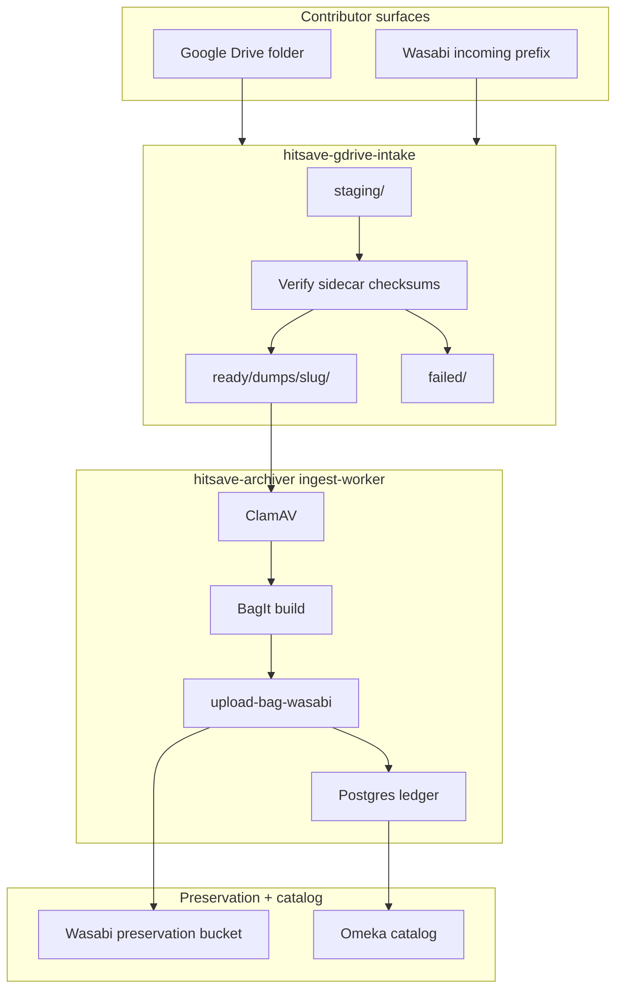

# Remote intake lanes (SSOT)

This document is the **single source of truth** for how Hit Save moves contributor material from **Google Drive** and **Wasabi incoming** into long-term preservation (BagIt, preservation Wasabi, Postgres ledger, Omeka catalog).

**Related repos**

| Repo | Role |
|------|------|
| [**hitsave-archiver**](https://github.com/hitsave/hitsave-archiver) (this repo) | ClamAV, BagIt, preservation Wasabi upload, ledger, Omeka registration |
| [**hitsave-gdrive-intake**](https://github.com/hitsave/hitsave-gdrive-intake) | Drive poll, Wasabi incoming poll, download, **fixity**, local `ready/` handoff YAML |
| **hitsave-archiver-config** (private) | Credentials, operator `database.yaml`, lane inventory (IDs/prefixes), optional `wasabi-*-intake.yaml` |

**Do not commit** Drive folder IDs, incoming bucket names tied to contributors, or host paths in the public repo. Copy [`config/preservation/lane-inventory.template.yaml`](../config/preservation/lane-inventory.template.yaml) into your private config checkout and fill it in locally.

Tracking: GitHub [Phase 0–5 remote intake issues](https://github.com/hitsave/hitsave-archiver/issues?q=is%3Aissue+Remote+intake+lanes).

---

## Principles

1. **Two-stage storage** — Contributors drop files in **incoming** surfaces (Drive or a Wasabi bucket used for intake). After archiver ingest, authoritative copies live in **preservation buckets** configured in [`config/preservation/ingest.yaml`](../config/preservation/ingest.yaml) (`wasabi.buckets.*`). Intake repos **never** write preservation buckets directly.
2. **Community dump sidecars (Redump, No-Intro, …)** — Official game dumps we preserve are reported to **community-run catalog organizations**. Each package includes a **sidecar** (e.g. Redump `submissionInfo.txt` / `!submissionInfo.txt`) with checksums, official title, system/category, and related metadata. **gdrive-intake verifies fixity against that sidecar before `ready/`**; archiver then classifies the SIP, enriches catalog from the sidecar where supported (Redump today; other orgs as parsers land), and runs ClamAV + BagIt. **All remote dump lanes follow this same pipeline** — only the sidecar format and incoming folder differ.
3. **Lane = routing + provenance** — Each lane fixes `ingest_kind`, submission provenance ([`submission-sources.yaml`](../config/preservation/submission-sources.yaml)), container SIP path, and catalog behavior ([`ingest-kinds.yaml`](../config/preservation/ingest-kinds.yaml)).
4. **Minimal handoff YAML** — Per-package configs list **`ingest_kind`**, SIP location, and **`omeka_item_title`**. Ledger **`game_key`** (`package_id`) is assigned at ingest ([`config-contract.md`](./config-contract.md)).

---

## End-to-end flow (community dumps)

Same flow for **Redump**, **No-Intro**, and future org sidecars; intake profile names may differ, steps do not.



**Handoff files** (under each `ready/…` package directory, produced by gdrive-intake):

| File | Purpose |
|------|---------|
| `game.ingest.yaml` | Entrypoint for `ingest-folder.py` — `ingest_kind: dump`, `source_game_folder`, title |
| `hitsave-submission.yaml` | Catalog/provenance (sidecar-derived fields, expected Wasabi layout, source notes) |

See [gdrive-intake-handoff.md](./gdrive-intake-handoff.md) and [hitsave-gdrive-intake `docs/archiver-handoff.md`](https://github.com/hitsave/hitsave-gdrive-intake/blob/main/docs/archiver-handoff.md).

---

## Lane catalog (target state)

Status key: **Live** = implemented today · **Planned** = documented here; work in GitHub phases · **Sunset** = finishing; no new work after cutoff.

| Lane | Status | Contributor surface | Intake | Archiver `ingest_kind` | Preservation Wasabi | Omeka |
|------|--------|----------------------|--------|------------------------|---------------------|-------|
| **Community dumps** (Redump, No-Intro, …) | **Live** | Drive child folders; Wasabi incoming prefixes per drop zone | gdrive-intake dump profile + **sidecar checksum verify** (Redump implemented first) | `dump` — `dump_class` from sidecar (`redump` when Redump sidecar valid; extend for other orgs) | `wasabi.buckets.dumps` / layout in [dump-preservation.md](./dump-preservation.md) | `apply_dump_catalog_omeka.py` (+ org-specific enrichment) |
| **Analog media** | **Planned** ([#17](https://github.com/hitsave/hitsave-archiver/issues/17)) | Dedicated Drive folder and/or incoming prefix | gdrive-intake analog profile (no community dump sidecar gate) | `analog` | `wasabi.buckets.analog` / `analog/{relative_sip_path}/` | TBD (no Moby by default) |
| **Press material** | **Sunset** ([#20](https://github.com/hitsave/hitsave-archiver/issues/20)) | On-site tree only (no remote intake) | — | `press_material` | `wasabi.buckets.press_material` | Moby + press profile |
| **Portable zip** | **Live** | SFTP / shared zip to submissions volume | `ingest-submission.py` | From manifest or `submissions.yaml` | Same as kind (usually press) | Register after ingest |

**Additional dump drop folders** (e.g. Nintendo Switch-only incoming paths) are **not a separate preservation pipeline** — they use the **community dumps** row: sidecar + verify + same archiver path ([#18](https://github.com/hitsave/hitsave-archiver/issues/18) covers extra Drive/Wasabi roots and handoff profiles).

Dump layout details: [dump-preservation.md](./dump-preservation.md). Wasabi buckets: [preservation-wasabi.md](./preservation-wasabi.md).

---

## Recommended directory layout (target)

Use **lane subdirectories** under one intake root so provenance prefixes stay distinct:

```text
{HOST_GDRIVE_INTAKE}/          →  gdrive-intake container /data/intake
  staging/
  failed/
  ready/
    dumps/{slug}/              community dumps (Redump, No-Intro, …) — sidecar + images
    analog/{slug}/               (planned)

Optional on-site analog tree (alternative to ready/analog):
  {HOST_ANALOG}/               →  ingest-worker /data/analog  (planned mount)
```

Today many deployments use a flat `ready/{slug}/` tree (Redump-only); splitting under `ready/dumps/` is the target when multiple dump drop zones share one mount ([#16](https://github.com/hitsave/hitsave-archiver/issues/16)).

Container bind mounts (archiver) today: `ready/` → `/data/gdrive-intake/ready`. Planned: `HOST_ANALOG` → `/data/analog` ([#17](https://github.com/hitsave/hitsave-archiver/issues/17)).

Each lane needs a **`submission-sources.yaml`** row: longest `container_path_prefix` match against `source_game_folder` ([`submission-sources.yaml`](../config/preservation/submission-sources.yaml)).

---

## Operator inventory (private)

Maintain **`preservation/lane-inventory.yaml`** in **hitsave-archiver-config** (gitignored). Start from the public template:

```bash
cp hitsave-archiver/config/preservation/lane-inventory.template.yaml \
   hitsave-archiver-config/preservation/lane-inventory.yaml
```

Fill in Drive folder IDs, Wasabi incoming bucket/prefixes, and host env variable values **only** in that private file. The template lists **lane id**, **`ingest_kind`**, and placeholder fields — no secrets in git.

---

## Per-lane workflows (summary)

### Community dumps — Redump, No-Intro, … (live)

1. **Configure** — gdrive-intake `config/gdrive.yaml`, `config/intake.yaml` (dump profile / sidecar names); archiver `submission-sources` for the ready-tree prefix; private `preservation/wasabi-redump-intake.yaml` for Wasabi drop zones ([example](../config/preservation/wasabi-redump-intake.yaml.example), [gdrive-intake README](https://github.com/hitsave/hitsave-gdrive-intake)).
2. **Stage** — `gdrive-intake poll --once` / `process --folder-id …`, or `poll-wasabi` / `process-wasabi …` (sidecar verify before promote to `ready/`).
3. **Ingest** — `docker compose run --rm ingest-worker /data/gdrive-intake/ready/<slug>/game.ingest.yaml`
4. **Catalog** — `scripts/remote-intake/register-dump-omeka.sh` or `register-prod-dumps-omeka.sh` ([gdrive-intake-handoff.md](./gdrive-intake-handoff.md)).
5. **Batch (operator)** — `scripts/remote-intake/run-gdrive-redump-per-folder.sh`, `run-wasabi-redump-per-folder.sh`, or full-batch wrappers; logs under `.generated/` ([README](../scripts/remote-intake/README.md)).
6. **Incoming cleanup (optional)** — After acceptance passes: move Drive folders to sibling/child `processed/` (`move-gdrive-redump-to-processed.sh`); MOVE Wasabi incoming keys to `processed/…` (`move_wasabi_intake_to_processed.py`). Do **not** move or ingest Drive folders that lack a disc image when the full SIP exists on Wasabi only.

Redump is the **reference sidecar** implemented today; No-Intro and other org sidecars should reuse this flow as parsers and verify rules are added ([#16](https://github.com/hitsave/hitsave-archiver/issues/16)).

**Automated spot-check (one package):** `scripts/remote-intake/acceptance-redump-package.sh --slug '<ready-slug>'`.

### Nintendo Switch dumps (in progress, [#18](https://github.com/hitsave/hitsave-archiver/issues/18))

Contributor layout: **`{game title}/Scans/`** (photos) and **`{game title}/{version}/`** (No-Intro-style **`Submission.xml`**, cart **`.xci`**, `.bin` sidecars). **Ingest SIP = the game title folder** (BagIt includes everything: `Scans/`, each `{version}/`, and sidecars). Sidecar XML is resolved under a version subfolder when absent at the game root. Archiver **`dump_class: switch`** → Wasabi `dumps/Nintendo Switch/{sort_letter}/{package_id}/`. Omeka catalog uses folder title + version label (no box/cart serials); title ID (`gameid1`) may be stored as `dcterms:identifier`.

### Analog (planned)

Same poll/process/ingest pattern with **`ingest_kind: analog`**, folder tree preserved under `analog_material_root`, Moby off. See [#17](https://github.com/hitsave/hitsave-archiver/issues/17).

### Press material (sunset)

Batch expand + `run-batch-resume-omeka.sh` on [`/data/press-material`](../config/preservation/ingest.yaml) — [e2e-preservation-batch.md](./e2e-preservation-batch.md). No new batches after operator cutoff ([#20](https://github.com/hitsave/hitsave-archiver/issues/20)).

### Portable zip (live)

[portable-submissions.md](./portable-submissions.md) — submissions volume, optional `hitsave-submission.yaml` in zip.

---

## Acceptance checklist (every lane, every package)

Use after stage + ingest; repeat after code or config changes.

| Step | Check | Pass criteria |
|------|--------|----------------|
| 1. Stage | Intake `ready/` tree | Handoff YAML present; package not in `failed/` |
| 2. Sidecar | Community dumps only | Checksums/size match sidecar before archiver (intake verify) |
| 3. Provenance | Submission source | Ingest registers ledger row (no “no submission-sources match”) |
| 4. Scan | ClamAV | Ledger not `quarantine` / virus error |
| 5. BagIt | Local output | Ledger `complete`; bag under `/output/bag/…` |
| 6. Preservation Wasabi | Upload | `package_storage_prefix` set; objects in correct **preservation** bucket ([preservation-wasabi.md](./preservation-wasabi.md)) |
| 7. Omeka | Catalog | `omeka_item_id` set when lane requires public catalog |
| 8. Idempotency | Re-run ingest/register | Skips or no-ops without duplicate items (batch resume scripts) |
| 9. Incoming cleanup | Policy | Optional: remove Drive / **incoming** Wasabi copy only after prior steps pass (operator policy) |

**Ledger spot-check** (container paths):

```bash
docker compose exec -T postgres psql -U hitsave -d hitsave_ledger -c \
  "SELECT game_key, ingest_kind, status, package_storage_prefix, omeka_item_id
   FROM game_ingest ORDER BY updated_at DESC LIMIT 10;"
```

---

## Configuration map (public SSOT files)

| Concern | File |
|---------|------|
| Container paths, Wasabi preservation buckets | [`config/preservation/ingest.yaml`](../config/preservation/ingest.yaml) |
| Kind → Moby, dump layout | [`config/preservation/ingest-kinds.yaml`](../config/preservation/ingest-kinds.yaml) |
| SIP provenance | [`config/preservation/submission-sources.yaml`](../config/preservation/submission-sources.yaml) |
| Host env variable **names** | [`config/host.env.example`](../config/host.env.example) |
| Omeka API target | [`config/omeka-catalog.yaml`](../config/omeka-catalog.yaml) |
| Lane inventory (operator copy) | [`config/preservation/lane-inventory.template.yaml`](../config/preservation/lane-inventory.template.yaml) |

Private: `hitsave-archiver-config/secrets/*`, `preservation/database.yaml`, filled `lane-inventory.yaml`, Wasabi incoming YAML (e.g. `wasabi-redump-intake.yaml`).

---

## Implementation phases (GitHub)

| Phase | Issue | Focus |
|-------|-------|--------|
| 0 | [#15](https://github.com/hitsave/hitsave-archiver/issues/15) | This document + inventory template |
| 1 | [#16](https://github.com/hitsave/hitsave-archiver/issues/16) | Community dump intake hardening (Drive + Wasabi; Redump reference) |
| 2 | [#17](https://github.com/hitsave/hitsave-archiver/issues/17) | Analog lane |
| 3 | [#18](https://github.com/hitsave/hitsave-archiver/issues/18) | Additional dump drop folders (same sidecar pipeline) |
| 4 | [#19](https://github.com/hitsave/hitsave-archiver/issues/19) | Scheduling / visibility |
| 5 | [#20](https://github.com/hitsave/hitsave-archiver/issues/20) | Press material sunset |

---

## See also

- [gdrive-intake-handoff.md](./gdrive-intake-handoff.md) — Community dump handoff commands (archiver side; Redump today)
- [dump-preservation.md](./dump-preservation.md) — Dump BagIt and Wasabi prefixes
- [config-contract.md](./config-contract.md) — Game YAML and batch files
- [operator-config.md](./operator-config.md) — Private config checkout
